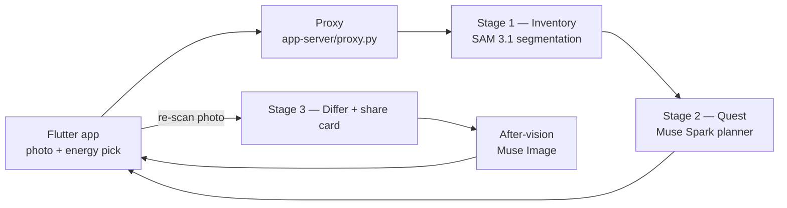

# TidyQuest

**Snap a photo of the mess. Get a cozy quest sized to the energy you actually have. Tidy at your pace — progress is proven by a re-scan, never by shame.**

TidyQuest turns one photo of an overwhelming space — a room, a car interior — into a game-like tidying quest, built on Meta's AI tooling for the Meta Global AI Developer Hackathon (Startup track).

## What it does

1. **Photograph the space.** One picture is the whole setup.
2. **Get a quest chain sized to you.** You declare your energy — **"I can barely stand," "10 minutes," "An hour," or "Full send"** — and Muse Spark plans quests that fit that budget. Zones become quests, smallest first; the biggest zone is a **Boss Battle**; mystery items become **Mystery Box** steps instead of blockers.
3. **Check off steps.** Trash goes first, surfaces reset last. Low-energy day? The reroute is built in and worded like what it is: strategy, not retreat.
4. **Re-scan to prove it.** A second photo is diffed against the first, zone by zone. The differ — not self-report — says what was cleared.
5. **Keep the card.** A finished run produces a before/after share card, privacy-processed and ready to share — carrying your *after-vision*, the same space tidied, generated by Muse Image as the reward for finishing.

**The dignity principle:** there are no fail states, no streak loss, no countdown timers. Rest is a legitimate move. Effort is celebrated; the plan bends to the person's day, never the other way around.

## How it works



| Stage | Meta tooling | What it does |
|---|---|---|
| Inventory | **SAM 3.1** (`sam-3.1`) | Segments the photo into items on a 3×3 zone grid; deduplicated masks become a structured inventory (`schemas/inventory.schema.json`) |
| Quest plan | **Muse Spark** (`muse-spark-1.3` / `1.2`) | Turns the inventory into an energy-budgeted quest chain — zones, Boss Battle, Mystery Box steps, trash-first ordering (`schemas/quest.schema.json`) |
| After-vision | **Muse Image** (`muse-image-1.0`) | Generates the tidied-room after-vision delivered on the completion share card |
| Prove it | Pipeline differ | Re-scan diff at zone level (counts, coverage, category deltas) — honest even when the two photos are shot from different angles |

The staged Python pipeline lives in `pipeline/`; the two JSON schemas in `schemas/` are the contracts every stage is built against. During development the team ran local stand-ins (SAM 2.1 + a local VLM) behind the same schemas, then swapped the backends to the Meta Model API — the schema is the contract, the backend is one config change.

## Privacy & BYOK

- **Mirrors and faces are blurred before anything is shared.** Every visual the app displays or exports passes through `apply_privacy()`: faces are detected and blurred, and mirror regions recorded in a human-marked registry are blurred too. The proxy never returns raw uploaded bytes — only privacy-processed overlays and cards. A photo known to contain a mirror but missing a registry entry is refused, not shipped.
- **Bring your own key.** The Meta Model API key is yours: entered in the app's key field (empty by default), sent per request as `X-Meta-API-Key`, held by the proxy only for the scope of that request — never stored, never logged, never echoed. No key is embedded in this repo or in the shipped app.
- **Family test photos are internal test assets only** and are not in this repository. The two demo spaces were explicitly cleared for the demo by their owner.

## Demo mode (for judges)

You don't need our house, our network, or a messy room. The app ships with a **demo mode** that runs on pre-cached pipeline outputs for two real spaces — a car backseat (the progress-proof pair) and a bathroom (the hero quest visual) — so the full loop, Boss Battle included, can be experienced end to end. A public endpoint is being provisioned at **tidyquest.ignisalgos.com** for the live path.

## Project status

Hackathon build, in active development: pipeline stages 1–3, the Flutter app, and the demo are built and verified; the live Meta Model API migration is complete — SAM 3.1, Muse Spark, and Muse Image all run live against the Meta Model API. **Submission: November 4, 2026.** Judging criteria we built against: Impact 30% · Use of Meta AI Tooling 25% · Demo 25% · Technical Depth & Execution 20%.

Scope is deliberately bounded: one space per quest. No whole-house mode in v1.

## Repo layout

```
pipeline/     Stage 1 inventory, stage 2 quest engine, stage 3 card/differ,
              privacy, Meta API adapters, validation, tests
app/          Flutter app (lib/, test/, pubspec.yaml) — package com.ignisalgos.tidyquest
app-server/   proxy.py — the thin server the app talks to (port 8001)
schemas/      inventory.schema.json · quest.schema.json — the contracts
BUILD_README.md  Build notes, decisions, and run instructions
PROGRESS_LOG.md  The project's build log
```

## Team

**Ignis Algos** — Damon Pettigrew (team representative) and Diana Walker. Built with Remy (Diana's agent) and Baymax (Damon's agent) for the Meta Global AI Developer Hackathon, October 26 – November 4, 2026.
